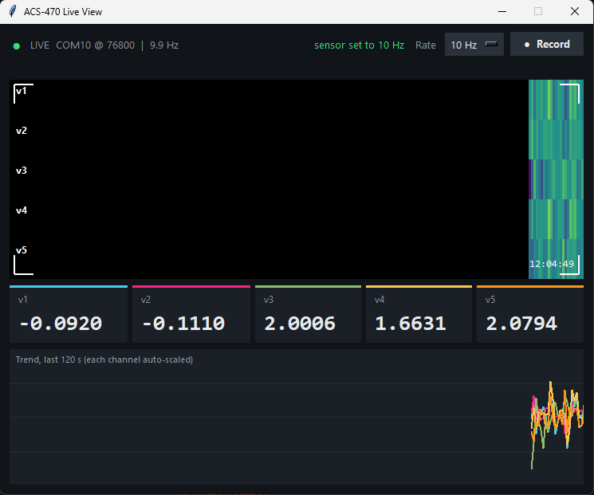
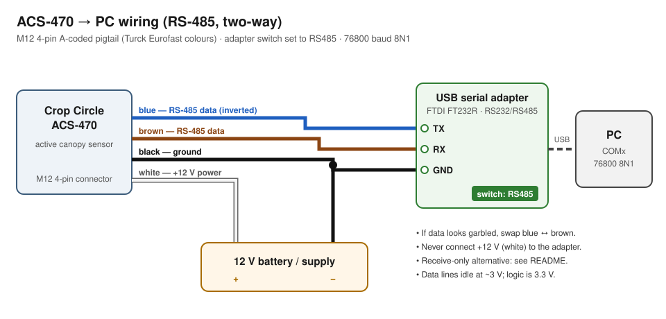

# ACS-470 PC Interface

Read, view, log **and configure** a Holland Scientific **Crop Circle ACS-470**
active canopy sensor directly from a PC, with no GeoSCOUT logger and no vendor
software. You need a USB-to-RS485 adapter and Python.



- **Live viewer:** a scrolling "line-scan" image, big live readouts, a trend chart, a Record button and a rate selector.
- **Logger:** writes every reading to CSV with PC timestamps.
- **Rate control:** sets the sensor's output rate (2, 10 and 25 Hz verified) using the command protocol recovered from a GeoSCOUT GLS-400.
- **Full write-up** of the wiring, the protocol and how it was all worked out, for when your setup is slightly different.

> The ACS-470 serial protocol is not publicly documented. Everything here was
> observed on one sensor (October 2026). It works, but treat it as
> reverse-engineered rather than official.

---

## Hardware

| Part | Notes |
|---|---|
| Crop Circle ACS-470 | Tested with filters giving the 5-value output described below |
| M12 4-pin A-coded pigtail cable | Female M12 on one end, bare wires on the other (Turck *Eurofast* style, standard colours) |
| USB serial adapter with **RS-485** mode | Tested: FTDI FT232R-based adapter with an RS232/RS485 switch and TX / RX / GND terminals |
| 12 V supply | Battery or bench supply for the sensor |
| Multimeter | Recommended, for checking wires before connecting |

## Wiring



| Pigtail wire | Function | Connect to |
|---|---|---|
| **White** | +12 V power in | 12 V supply **+** |
| **Black** | Ground | 12 V supply **−** **and** adapter **GND** |
| **Brown** | RS-485 data | adapter **RX** |
| **Blue** | RS-485 data (inverted) | adapter **TX** |

Set the adapter's switch to **RS485**. In that mode the adapter's TX/RX
terminals act as the RS-485 A/B pair.

- **Data looks garbled** (random symbols instead of numbers): swap blue and brown.
- **Never connect white (+12 V) to the adapter.**
- **Check the colours with a multimeter** before connecting: white↔black should read about +12 V, and brown and blue should each read about +3 V against black.
- **Cables can differ.** Other cables or sensor revisions may use different colours.

**Receive-only (one-way) setup:** brown → adapter RX plus black → GND on a
3.3 V TTL serial input is enough to *read* data. That is how this project
started. Changing the sensor's rate needs the two-way RS-485 wiring above.

## Software setup

Requires Python 3.9+ (tested on 3.12, Windows 11).

```bash
pip install -r requirements.txt
```

The adapter appears as a COM port (e.g. `COM10`). The tools auto-detect FTDI
adapters; pass `--port COMx` otherwise.

## Usage

```bash
python acs470_viewer.py               # live view; sets 10 Hz on connect
python acs470_viewer.py --rate 25     # start at 25 Hz

python acs470_logger.py --rate 10     # terminal logger -> data/acs470_<time>.csv
python acs470_config.py 5             # just change the rate

python acs470_sniff.py                # listen-only bus recorder (see docs)
```

- **Only one program can use the COM port at a time.** "Access denied" means another one is still open.
- **The sensor forgets its rate when power is lost** and returns to its default. The viewer re-sends the rate automatically when it sees the rate drop. With the logger, use `--rate` each time.
- **The viewer** shows the last 120 s. At high rates it averages readings for display; Record saves every raw reading.
- **CSV columns:** `pc_time_iso, v1, v2, v3, v4, v5, raw`.

## Data format

Each sample is one ASCII line, `v1, v2, v3, v4, v5`:

```
 0.403, 0.936, 8.8303,20.7646, 0.6818     <- sensor over green leaves
-0.054,-0.062, 2.0339, 1.8262, 2.0662     <- sensor over a desk
```

| Column | Meaning (with 670 / 730 / 760 nm filters) | How we know |
|---|---|---|
| **v1** | **NDRE** = (NIR − RedEdge) / (NIR + RedEdge) | equals (v4 − v3)/(v4 + v3) to within 0.0006 on every logged row |
| **v2** | **NDVI** = (NIR − Red) / (NIR + Red) | equals (v4 − v5)/(v4 + v5) to within 0.0005 on every logged row |
| **v3** | Red-edge reflectance (~730 nm) | medium over leaves |
| **v4** | NIR reflectance (~760 nm) | highest over leaves, and used in both indices |
| **v5** | Red reflectance (~670 nm) | near zero over leaves (chlorophyll absorbs red) |

The **formulas** for v1 and v2 are verified from data. The **band
assignment** is inferred from the leaf readings and depends on which filters
are installed. Check your filters: if v3 is a green filter (~550 nm), then v1
is green NDVI instead of NDRE. v3–v5 are relative reflectances unless the
sensor has been calibrated (e.g. with a FieldCAL SC-1).

A small sample recording is in [`examples/sample_data_2hz.csv`](examples/sample_data_2hz.csv).

## Protocol summary

RS-485, **76800 baud 8N1**, ASCII. Commands are NMEA-style:

```
$AUTOOFF,99*4D                    stop auto-send (sent 3x)
$NEWCFG,99,ON,HI,S10,AUTO*DC      new config: S<n> = n Hz, AUTO = resume sending
$OK,00*                           sensor's acknowledgement
```

The checksum is `(~sum(bytes between '$' and '*')) & 0xFF`, which is *not* the
usual NMEA XOR. Full details, timing and unknowns:
[docs/protocol.md](docs/protocol.md).

## Repository layout

```
acs470_viewer.py      live viewer GUI (Tkinter, no extra deps)
acs470_logger.py      command-line CSV logger
acs470_config.py      rate control + checksum (protocol implementation)
acs470_sniff.py       listen-only RS-485 recorder for decoding a GLS-400
requirements.txt
docs/
  wiring.svg                  main wiring diagram
  wiring_gls400_sniff.svg     how to listen in on a GeoSCOUT GLS-400
  protocol.md                 serial protocol reference
  how-it-was-figured-out.md   investigation notes, techniques, gotchas
  viewer.png
captures/             raw recordings of a GLS-400 configuring the sensor
examples/             sample CSV output
data/                 your recordings (git-ignored)
```

## Troubleshooting

| Symptom | Fix |
|---|---|
| No COM port appears | Re-plug the USB; check the FTDI driver in Device Manager |
| "Access denied" opening the port | Close the other program using it (viewer, logger, sniffer) |
| Random symbols instead of numbers | Swap blue and brown; check the switch is on RS485; check baud is 76800 |
| Data but rate change gets "no reply" | Check blue and brown are both connected (two-way needs both) and nothing else is driving the bus (e.g. a GLS-400) |
| Rate falls back to 2 Hz | Sensor lost power; it doesn't store settings. Re-send the rate (the viewer does this itself) |
| One odd line with huge numbers after a rate change | Normal transitional line; it's filtered out |

## How this was figured out

The original instructions said "RS-232 on the brown wire", and the sensor
turned out to speak RS-485 at an unusual 76800 baud. The command set was
recovered by recording a GeoSCOUT GLS-400 configuring the sensor. The
techniques (measuring baud rate with the UART, identifying RS-485 with a
multimeter, tapping a shared bus, brute-forcing a checksum) are written up
in [docs/how-it-was-figured-out.md](docs/how-it-was-figured-out.md), in case
your model or cable differs.
